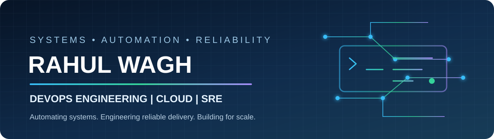

 

### DevOps Engineer | Cloud | Site Reliability Engineering

**Automating operations • Improving delivery • Building reliable systems**

<a href="https://www.linkedin.com/in/rahulnwagh/">LinkedIn</a> · <a href="https://github.com/Rjwagh2001">GitHub</a>

---

## 👋 About

System Engineer at **TCS**, working with the DevOps team on automation, CI/CD and production reliability. Interested in building dependable delivery systems, improving observability and solving infrastructure challenges through engineering.

## ⚙️ Engineering Focus

| | |
|---|---|
| ⚙️ **Automation** | GitHub Actions · Shell scripting · Workflow orchestration |
| 🚀 **CI/CD** | Jenkins · Build and release workflows · Deployment validation |
| 🔍 **Reliability** | Incident investigation · MIM collaboration · Postmortems |
| 📊 **Observability** | Prometheus · Grafana · Loki |

## 🧰 Technology Stack

**Systems & Scripting**

**CI/CD & Build**

**Cloud & Containers**

**Monitoring**

## 🏗️ Professional Engineering

- **Production automation:** Designed GitHub Actions workflows for production change and patch-deployment activities, including CR generation.
- **Reliability engineering:** Contribute to production incident and MIM investigations, technical resolution, cross-team coordination and postmortems.
- **Delivery engineering:** Work on Jira sprint tasks involving CI/CD workflows, application deployment and release validation.
- **Observability:** Currently building Prometheus metrics collection, Grafana dashboards and Loki-based log visibility.

## 🚀 Featured Projects

| Repository | Focus |
|---|---|
| [Kubernetes Labs](https://github.com/Rjwagh2001/K8s) | Kubernetes · Deployments · Services · Ingress |
| [Jenkins Zero to Hero](https://github.com/Rjwagh2001/Jenkins-Zero-To-Hero) | CI/CD · Jenkins · Maven · SonarQube · Nexus |
| [Linux SRE Handbook](https://github.com/Rjwagh2001/linux-sre-handbook) | Linux · Shell scripting · Troubleshooting |
| [Networking Handbook](https://github.com/Rjwagh2001/networking-handbook) | Networking · Connectivity · Troubleshooting |
| [Tomcat SRE Handbook](https://github.com/Rjwagh2001/Tomcat-SRE-Handbook) | Tomcat · Deployment · Application diagnostics |

## 🏅 Certifications

## 📈 GitHub Activity

---

**Build with purpose. Automate with discipline. Engineer for reliability.**

